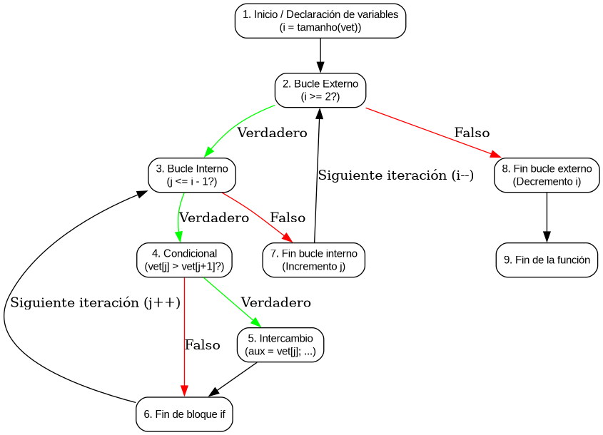

# IS2_Lab4_UnitTests

Laboratorio 4 de Ingeniería de Software II: pruebas unitarias (xUnit/`unittest`) sobre una implementación de **Bubble Sort**, con análisis de cobertura usando `coverage.py` y grafo de flujo de control (CFG) derivado del código fuente.

## Estructura del proyecto

```
├── src/
│   └── bubble_sorter.py      # Implementación de Bubble Sort (SUT)
├── tests/
│   └── test_bubble_sorter.py # Pruebas unitarias (CP1, CP3, CP4)
├── docs/
│   ├── CFG.dot                   # Definición Graphviz del CFG
│   ├── CFG.png                   # Grafo de flujo de control renderizado
│   ├── bubble.txt                # Pseudocódigo de referencia
│   ├── reporte_ejecucion.log     # Salida de la ejecución de los tests
│   └── reporte_cobertura.log     # Reporte de cobertura (terminal)
├── htmlcov/                      # Reporte de cobertura en HTML
├── requirements.txt              # Dependencias (coverage)
└── .gitignore
```

## Grafo de flujo de control (CFG)



## Configuración del entorno

Requisitos: Python 3.

```bash
# 1. Crear entorno virtual
python3 -m venv .venv

# 2. Activar el entorno virtual
source .venv/bin/activate        # Linux/macOS
# .venv\Scripts\activate         # Windows

# 3. Instalar dependencias
pip install -r requirements.txt
```

## Ejecución de pruebas

Ejecutar desde la raíz del proyecto (los tests importan `src.bubble_sorter`):

```bash
# Ejecutar las pruebas
python -m unittest discover -s tests -v

# Ejecutar pruebas con medición de cobertura
coverage run -m unittest discover -s tests -v
coverage report          # Reporte en terminal
coverage html            # Genera htmlcov/index.html
```

## Casos de prueba

| Caso  | Camino en el CFG                          | Descripción                                    | Entrada     | Salida esperada |
|-------|-------------------------------------------|------------------------------------------------|-------------|-----------------|
| CP1   | 1-2-8-9                                   | El bucle externo no se ejecuta                 | `[7]`       | `[7]`           |
| CP3   | 1-2-3-4-6-3-7-2-8-9                       | Vector ya ordenado: el `if` es falso           | `[1, 2, 3]` | `[1, 2, 3]`     |
| CP4   | 1-2-3-4-5-6-3-7-2-8-9                     | Vector desordenado: el `if` es verdadero       | `[2, 3, 1]` | `[1, 2, 3]`     |

Cada prueba sigue el patrón **Arrange-Act-Assert** y utiliza `setUp`/`tearDown` para inicializar y liberar la instancia de `BubbleSorter`.

## Resultados

- **3 pruebas ejecutadas, 3 correctas** (ver `docs/reporte_ejecucion.log`)
- **Cobertura: 100%** de sentencias y ramas en `src/bubble_sorter.py` (ver `docs/reporte_cobertura.log` y `htmlcov/`)
